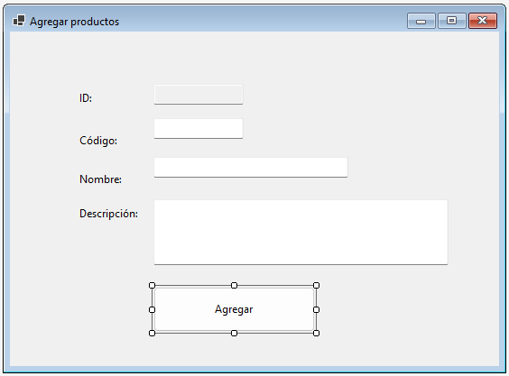

# Métodos de caálogo

# Diseño del formulario Form1



## Método para agregar productos en ProductoDAL

```chsarp
        public static int Agregar(Producto param1)
        {
            int id = 0; // Para indicar que no se ha agrega el empleado.
            try
            {
                using (SqlConnection conn = ConexionBD.Conectar())
                {

                    SqlCommand cmd = new SqlCommand("insert into Productos(codigo, nombre, descripcion) OUTPUT INSERTED.Id values(@Codigo,@Nombre,@Descripcion)", conn);
                    //OUTPUT INSERTED.Id 
                    cmd.Parameters.AddWithValue("@Codigo", param1.Codigo);
                    cmd.Parameters.AddWithValue("@Nombre", param1.Nombre);
                    cmd.Parameters.AddWithValue("@Descripcion", param1.Descripcion);
                    object resultado = cmd.ExecuteScalar();
                    if (resultado != null && resultado != DBNull.Value)
                    {
                        id = Convert.ToInt32(resultado);
                    }
                    conn.Close();
                }
            }
            catch (Exception ex)
            {
                new Log(ex.Message);
            }
            return id;
        }
```

## Método para agregar productos en ProductoBLL

```chsarp
        public static int Agregar(Producto param1)
        {
           return ProductoDAL.Agregar(param1);
        }

```

## En evento Click del botón Agregar en FormAgregarProducto

```chsarp
            string codigo = txtCodigo.Text.Trim();
            string nombre = txtNombre.Text.Trim();
            string descripcion = txtDescripcion.Text.Trim();
            Producto p = new Producto(-1, codigo, nombre, descripcion);
            int id = ProductoBLL.Agregar(p);
            if(id > 0)
            {
                txtId.Text = id.ToString();
                MessageBox.Show("El producto se agregó", "Resultado", MessageBoxButtons.OK, MessageBoxIcon.Information);
            }
            else
            {
                MessageBox.Show("El producto NO se agregó", "Resultado", MessageBoxButtons.OK, MessageBoxIcon.Warning);
            }
```

Nombre.slnx