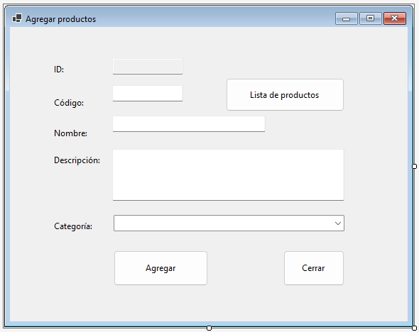

# Métodos de caálogo

# Diseño del formulario Form1

  

<table>
<tr>
<th>Nombre del control</th>
<th>Descripción</th>
</tr>
<td>txtId</td>
<td>ID del producto</td>
<tr>
</tr>
</tr>
<td>txtCodigo</td>
<td>Código del producto</td>
<tr>
</tr>
<td>txtNombre</td>
<td>Nombre del producto</td>
<tr>
</tr>
<td>txtDescripcion</td>
<td>Descripción del producto</td>
<tr>
</tr>
<td>cboCategorias</td>
<td>Combo de categorías de productos</td>
<tr>
</tr>
<td>btnAgregar</td>
<td>Agregar el producto en la tabla de base de datos</td>
<tr>
</tr>
<td>btnLista</td>
<td>Abrir el formulario para buscar, editar y eliminar productos</td>
<tr>
</tr>
<td>btnCerrar</td>
<td>Cerrar el formulario</td>
<tr>
<table>


## Clase Producto

```csharp
    public class Producto
    {
        public int Id { get; set; }
        public string Codigo { get; set; }
        public string Nombre { get; set; }
        public string Descripcion { get; set; }
        public Categoria Categoria { get; set;  }
        public Producto() { }
        public Producto(int id) {  Id = id; }
        public Producto(int id, string codigo, string nombre, string descripcion, Categoria categoria) {
            Id = id;
            Codigo = codigo;
            Nombre = nombre;
            Descripcion = descripcion;
            Categoria = categoria;
        }
    }
```

## Método para agregar productos en ProductoDAL

```csharp
        public static int Agregar(Producto param1)
        {
            int id = 0; // Para indicar que no se ha agrega el empleado.
            try
            {
                using (SqlConnection conn = ConexionBD.Conectar())
                {

                    SqlCommand cmd = new SqlCommand("insert into Productos(Codigo, Nombre, Descripcion, CategoriaId) OUTPUT INSERTED.Id values(@Codigo,@Nombre,@Descripcion, @CategoriaId)", conn);
                    //OUTPUT INSERTED.Id 
                    cmd.Parameters.AddWithValue("@Codigo", param1.Codigo);
                    cmd.Parameters.AddWithValue("@Nombre", param1.Nombre);
                    cmd.Parameters.AddWithValue("@Descripcion", param1.Descripcion);
                    cmd.Parameters.AddWithValue("@CategoriaId", param1.Categoria.Id);
                    object resultado = cmd.ExecuteScalar();
                    if (resultado != null && resultado != DBNull.Value)
                    {
                        id = Convert.ToInt32(resultado);
                    }
                    conn.Close();
                }
            }
            catch (Exception ex)
            {
                new Log(ex.Message);
            }
            return id;
        }
```

## Método para agregar productos en ProductoBLL

```csharp
        public static int Agregar(Producto param1)
        {
           return ProductoDAL.Agregar(param1);
        }

```

## En evento Click del botón Agregar en FormAgregarProducto

```csharp
        private void btnAgregar_Click(object sender, EventArgs e)
        {
            string codigo = txtCodigo.Text.Trim();
            string nombre = txtNombre.Text.Trim();
            string descripcion = txtDescripcion.Text.Trim();
            Categoria categoria = cboCategorias.SelectedItem as Categoria;
            Producto p = new Producto(-1, codigo, nombre, descripcion, categoria);
            int id = ProductoBLL.Agregar(p);
            if(id > 0)
            {
                txtId.Text = id.ToString();
                MessageBox.Show("El producto se agregó", "Resultado", MessageBoxButtons.OK, MessageBoxIcon.Information);
            }
            else
            {
                MessageBox.Show("El producto NO se agregó", "Resultado", MessageBoxButtons.OK, MessageBoxIcon.Warning);
            }
        }
```

## Evento Load del formulario AgregarProductos

:books: Con estas instrucciones se llena el combo de categorías de productos.  

```csharp
        private void FormAgregarProducto_Load(object sender, EventArgs e)
        {
            List<Categoria> categorias = CategoriaBLL.ObtenerTodos();
            cboCategorias.DataSource = categorias;
            cboCategorias.DisplayMember = "Nombre";
            cboCategorias.ValueMember = "Id";
        }
```

## Evento Click del botón para listar los productos

```csharp
        private void btnLista_Click(object sender, EventArgs e)
        {
            new FormListaProductos().ShowDialog();
        }
```