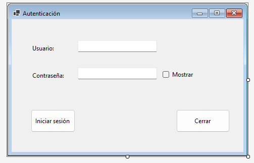

# Autenticación de usuarios

## Clase Empleado

```csharp
public class Empleado
{
    public int Id {  get; set; }
    public string? Codigo {  get; set; }
    public string? Nombre {  get; set; }
    public string? Apellido { get; set;  }
    public string? Telefono { get; set;  }
    public string? Correo { get; set;  }
    public Empleado() { }
    public Empleado(int id)
    {
        Id = id;
    }
    public Empleado(int id, string codigo, string nombre, string apellido, string telefono, string correo)
    {
        this.Id = id;
        this.Codigo = codigo;
        this.Nombre = nombre;
        this.Apellido = apellido;
        this.Telefono = telefono;
        this.Correo = correo;
    }
}
```

## Clase EmpleadoDAL

```csharp
public class EmpleadoDAL : ICatalogo<Empleado>
{
    public static bool Actualizar(Empleado param1)
    {
        throw new NotImplementedException();
    }

    public static int Agregar(Empleado param1)
    {
        throw new NotImplementedException();
    }

    public static Empleado Buscar(Empleado param1)
    {
        Empleado empleado = null;
        try
        {
            using (SqlConnection conn = ConexionBD.Conectar())
            {

                SqlCommand cmd = new SqlCommand("select Id,isnull(Codigo,''),Nombre, Apellido,isnull(Telefono,''),isnull(Correo,'') from Empleados Where Id = @Id", conn);
                cmd.Parameters.AddWithValue("@Id", param1.Id);
                SqlDataReader lector = cmd.ExecuteReader();
                if (lector.HasRows)
                {
                    if (lector.Read())
                    {
                        empleado = new Empleado(lector.GetInt32(0), lector.GetString(1), lector.GetString(2), lector.GetString(3), lector.GetString(4), lector.GetString(5));

                    }
                    lector.Close();
                }
                conn.Close();
            }
        }
        catch (Exception ex)
        {
            new Log(ex.Message);
        }
        return empleado;
    }

    public static bool Eliminar(Empleado param1)
    {
        throw new NotImplementedException();
    }

    public static List<Empleado> ObtenerTodos()
    {
        throw new NotImplementedException();
    }
}
```

## Clase EmpleadoBLL

```csharp
public class EmpleadoBLL : ICatalogo<Empleado>
{
    public static bool Actualizar(Empleado param1)
    {
        throw new NotImplementedException();
    }

    public static int Agregar(Empleado param1)
    {
        throw new NotImplementedException();
    }

    public static Empleado Buscar(Empleado param1)
    {
        return EmpleadoDAL.Buscar(param1);
    }

    public static bool Eliminar(Empleado param1)
    {
        throw new NotImplementedException();
    }

    public static List<Empleado> ObtenerTodos()
    {
        throw new NotImplementedException();
    }
}
```

## Clase Credendial en la capa InventarioAC.EL

```csharp
public class Credencial
{
    public string? Usuario {  get; set; }
    public string? Contrasena { get; set;  }
    public Empleado? Empleado { get; set; }
    public bool? Valida { get; set; }
}
```

## Clase AutenticacionDAL

```csharp
public class AutenticacionDAL
{
    public static Credencial Autenticar(Credencial credencial)
    {
        try
        {
            using (SqlConnection conn = ConexionBD.Conectar())
            {
                SqlCommand cmd = new SqlCommand(@"SELECT Id FROM Usuarios WHERE Usuario = @Usuario AND Contrasena = HASHBYTES('SHA2_256', @Contrasena)", conn);
                //cmd.Parameters.AddWithValue("@Usuario", credencial.Usuario);
                //cmd.Parameters.AddWithValue("@Contrasena", credencial.Contrasena );
                cmd.Parameters.Add("@Usuario", SqlDbType.VarChar, 50).Value = credencial.Usuario;
                cmd.Parameters.Add("@Contrasena", SqlDbType.VarChar, 100).Value = credencial.Contrasena;
                SqlDataReader lector = cmd.ExecuteReader();
                if (lector.HasRows)
                {
                    if (lector.Read())
                    {
                        credencial.Valida = true;
                        credencial.Empleado = EmpleadoDAL.Buscar(new Empleado(lector.GetInt32(0)));
                    }
                }
                conn.Close();
            }
        }
        catch (Exception ex)
        {
            new Log(ex.Message);
        }
        return credencial;
    }
}
```

## Clase AutenticacionBLL

```csharp
public class AutenticacionBLL
{
    public static Credencial Autenticar(Credencial credencial)
    {
        return AutenticacionDAL.Autenticar(credencial);
    }
}
```

## Diseño del formulario FormAutenticacion 

  

:warning: MATERIAL PENDIENTE de completar en esta guía; pero para la tarea del 27 de noviembre de 2026 es más que suficiente.  