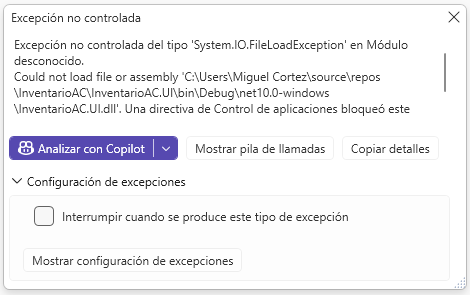
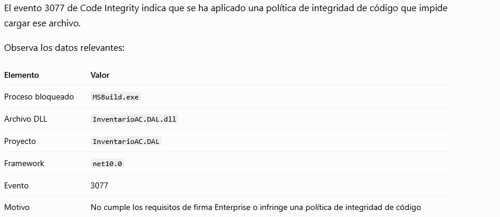
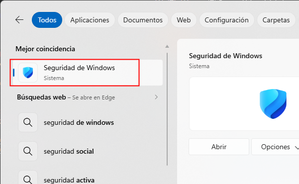
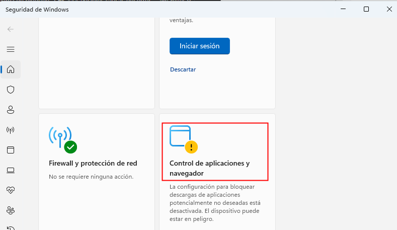
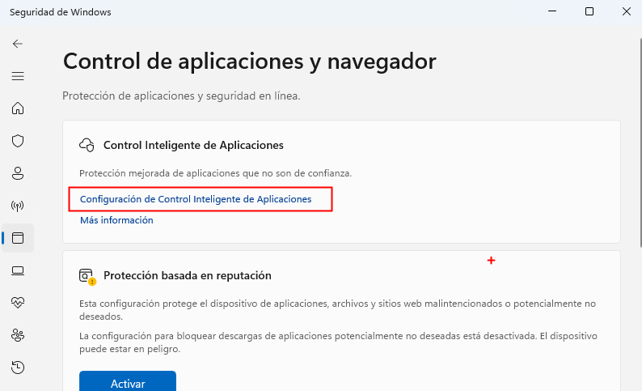
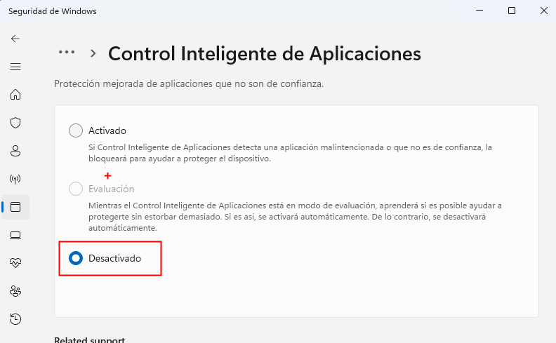

# Bloqueo de la aplicación

  

## Consultar el registro de eventos

1. Abre el Visor de eventos.

2. Ve a Registros de aplicaciones y servicios.

3. Microsoft → Windows → CodeIntegrity → Operational.

4. Busca eventos 3076 o 3077.

  

:books: El bloqueo se produce durante el proceso de compilación, cuando MSBuild intenta cargar tu biblioteca de acceso a datos.  

## Posibles causas del error  

- App Control for Business (WDAC): Windows tiene una política que exige que determinados archivos estén firmados por un editor autorizado.

- Política de integridad de código: una regla de seguridad impide ejecutar o cargar DLL que no cumplen determinados requisitos.

- DLL generada localmente: tu biblioteca InventarioAC.DAL.dll no tiene una firma reconocida por la política de seguridad del equipo.

https://support.microsoft.com/es-es/windows/security/threat-malware-protection/smart-app-control-has-blocked-part-of-this-app

## Desactivar la seguridad de aplicaciones

Paso 1. En la barra de tareas, justamente donde dice Buscar, escriba Seguridad de Windows 

  

Paso 2. Haga clic en Control de aplicaciones y navegado  

  

Paso 3. Haga clic Configuración de Centro de Inteligencia de Aplicaciones    

  

Paso 4. Haga clic en Desactivado  

  

