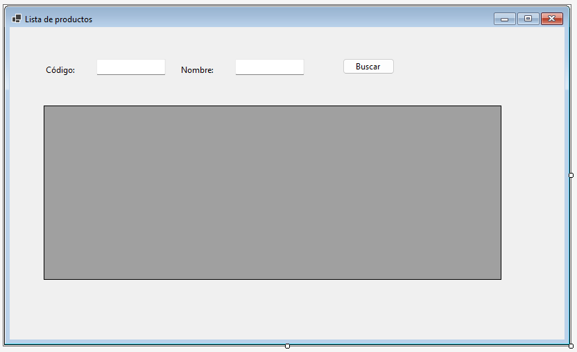

# Búsqueda de productos

## Sobrecarga del método Buscar() en la clase ProductoDAL

:books: Este método será usado para buscar productos por código (búsqueda exacta) o por aproximación usando LIKE mediante el campo nombre.  

```csharp
     public static List<Producto> Buscar(string codigo, string nombre)
     {
         List<Producto> lista = null;
         try
         {
             using (SqlConnection conn = ConexionBD.Conectar())
             {

                 SqlCommand cmd = new SqlCommand("select Id,Codigo,Nombre,Descripcion from Productos Where Codigo = @Codigo or Nombre LIKE @Nombre", conn);
                
                 cmd.Parameters.AddWithValue("@Codigo", codigo);
                 cmd.Parameters.AddWithValue("@Nombre", "%" + nombre + "%");
                 
                 SqlDataReader lector = cmd.ExecuteReader();
                 if (lector.HasRows)
                 {
                     lista = new List<Producto>();
                     while (lector.Read())
                     {
                         Console.Write(lector.GetInt32(0));
                         lista.Add(new Producto(
                             lector.GetInt32(0),
                             lector.GetString(1),
                             lector.GetString(2),
                             lector.GetString(3)));
                     }
                     lector.Close();
                 }
                 conn.Close();
             }
         }
         catch (Exception ex)
         {
             new Log(ex.Message);
         }
         return lista;
     }
     ```

## Sobrecarga del método Buscar() en la clase ProductoBLL

```csharp
        public static List<Producto> Buscar(string codigo, string nombre)
        {
            return ProductoDAL.Buscar(codigo, nombre);
        }
```

## FormListaProductos

:books: Este formulario permitirá buscar productos para visualizar los datos, editar o eliminar productos.  



Nombres de los controles: txtCodigo, txtNombre, btnBuscar, dgvProductos

## Código del evento Click del botón btnBuscar

```csharp
        private void btnBuscar_Click(object sender, EventArgs e)
        {
            string cod = txtCodigo.Text.Trim();
            string nomb = txtNombre.Text.Trim();
            List<Producto> lista = ProductoBLL.Buscar(cod,nomb);
            dgvProductos.DataSource = lista;
        }
```