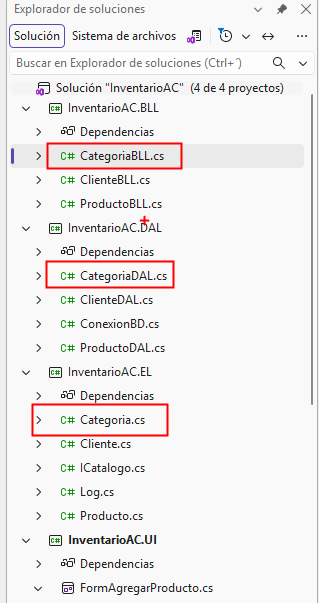

# Categorías de productos

  

## Categoria
```csharp
using System;
using System.Collections.Generic;
using System.Text;

namespace InventarioAC.EL
{
    public class Categoria
    {
        public int Id { get; set; }
        public string? Codigo { get; set; }
        public string Nombre { get; set; }
        public Categoria() { }
        public Categoria(int id)
        {
            Id=id;
        }
        public Categoria(int id, string? codigo, string nombre)
        {
            Id = id;
            Codigo = codigo;
            Nombre = nombre;
        }
        public override string ToString()
        {
            return "[" + this.Codigo + "] " + this.Nombre;
        }
    }
}

```

## CategoriaDAL
```csharp
using InventarioAC.EL;
using Microsoft.Data.SqlClient;
using System;
using System.Collections.Generic;
using System.Text;
using static System.Runtime.InteropServices.JavaScript.JSType;
namespace InventarioAC.DAL
{
    public class CategoriaDAL : ICatalogo<Categoria>
    {
        public static bool Actualizar(Categoria param1)
        {
            throw new NotImplementedException();
        }

        public static int Agregar(Categoria param1)
        {
            throw new NotImplementedException();
        }

        public static Categoria Buscar(Categoria param1)
        {
            Categoria categoria = null;
            try
            {
                using (SqlConnection conn = ConexionBD.Conectar())
                {

                    SqlCommand cmd = new SqlCommand("select Id,isnull(Codigo,''),Nombre from Categorias Where Id = @Id", conn);
                    cmd.Parameters.AddWithValue("@Id", param1.Id);
                    SqlDataReader lector = cmd.ExecuteReader();
                    if (lector.HasRows)
                    {
                        if (lector.Read())
                        {
                            categoria = new Categoria(lector.GetInt32(0), lector.GetString(1), lector.GetString(2));

                        }
                        lector.Close();
                    }
                    conn.Close();
                }
            }
            catch (Exception ex)
            {
                new Log(ex.Message);
            }
            return categoria;
        }

        public static bool Eliminar(Categoria param1)
        {
            throw new NotImplementedException();
        }

        public static List<Categoria> ObtenerTodos()
        {
            List<Categoria> lista = null;
            try
            {
                using (SqlConnection conn = ConexionBD.Conectar())
                {

                    SqlCommand cmd = new SqlCommand("select Id,isnull(Codigo,''),Nombre from Categorias", conn);

                    SqlDataReader lector = cmd.ExecuteReader();
                    if (lector.HasRows)
                    {
                        lista = new List<Categoria>();
                        while (lector.Read())
                        {
                            Categoria cat = new Categoria(lector.GetInt32(0), lector.GetString(1), lector.GetString(2));

                            lista.Add(cat);
                        }
                        lector.Close();
                    }
                    conn.Close();
                }
            }
            catch (Exception ex)
            {
                new Log(ex.Message);
            }
            return lista;
        }
    }
}
```

## CategoriaBLL

```csharp
using System;
using System.Collections.Generic;
using System.Text;
using InventarioAC.EL;
using InventarioAC.DAL;
namespace InventarioAC.BLL
{
    public class CategoriaBLL : ICatalogo<Categoria>
    {
        public static bool Actualizar(Categoria param1)
        {
            throw new NotImplementedException();
        }

        public static int Agregar(Categoria param1)
        {
            throw new NotImplementedException();
        }

        public static Categoria Buscar(Categoria param1)
        {
            throw new NotImplementedException();
        }

        public static bool Eliminar(Categoria param1)
        {
            throw new NotImplementedException();
        }

        public static List<Categoria> ObtenerTodos()
        {
            return CategoriaDAL.ObtenerTodos();
        }
    }
}
```