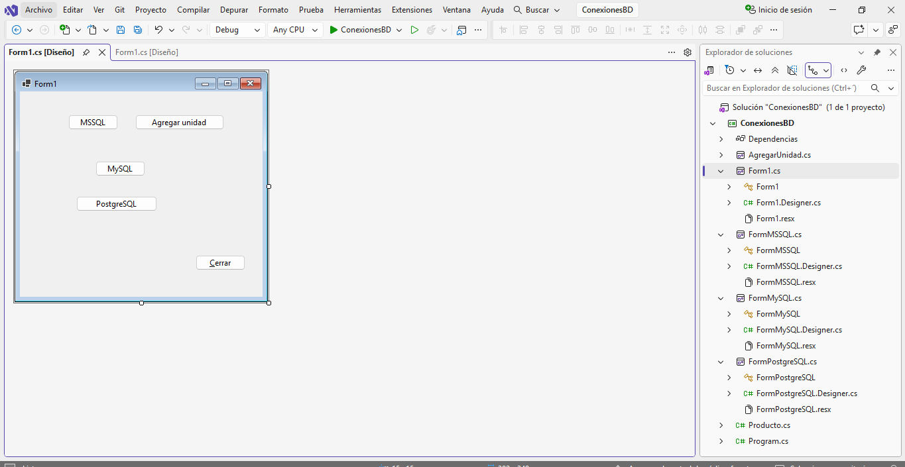
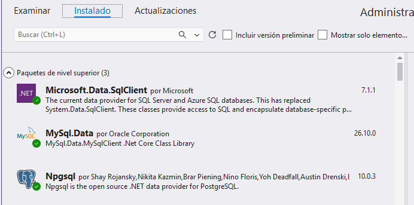
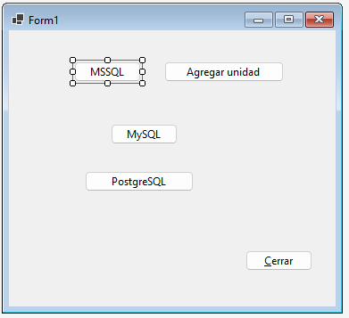
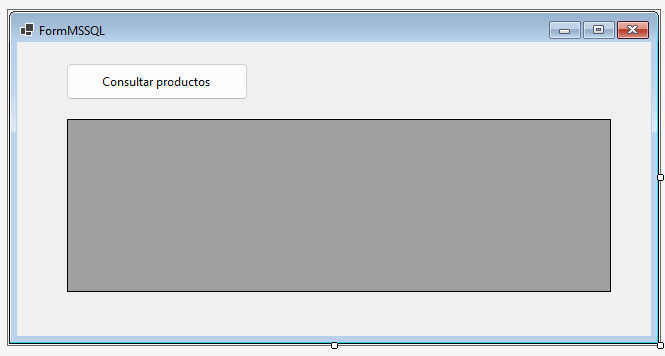
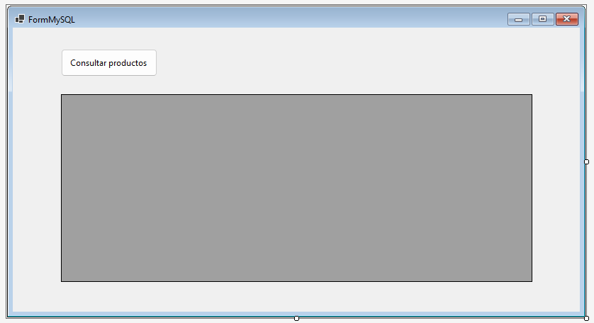
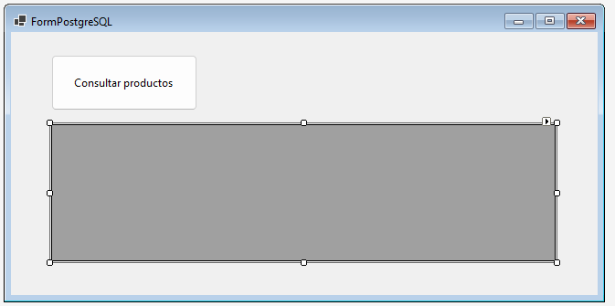
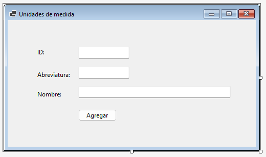

# Material de apoyo del proyecto de conexiones

## ¿Como se ve el proyecto abierto?



## Clase Producto

```csharp
using System;
using System.Collections.Generic;
using System.Text;

namespace ConexionesBD
{
    public class Producto
    {
        public int Id { get; set; }
        public string Nombre { get; set; }
        public Producto() { }
        public Producto(int id)
        {
            Id = id;
        }
        public Producto(int id, string nombre)
        {
            Id = id;
            Nombre = nombre;
        }
    }
}
```

## Paquetes NuGet.. instalados



## Form1



:books: Nombres de los controles: `btnMSSQL, btnMySQL, btnPostgreSQL, btnAgregarMSSQL, btnCerrar`

```csharp
namespace ConexionesBD
{
    public partial class Form1 : Form
    {
        public Form1()
        {
            InitializeComponent();
        }

        private void btnMSSQL_Click(object sender, EventArgs e)
        {
            FormMSSQL form = new FormMSSQL();
            form.Show();
        }

        private void btnMySQL_Click(object sender, EventArgs e)
        {
            FormMySQL form = new FormMySQL();
            form.Show();
        }

        private void btnPostgreSQL_Click(object sender, EventArgs e)
        {
            FormPostgreSQL form = new FormPostgreSQL();
            form.Show();
        }

        private void btnCerrar_Click(object sender, EventArgs e)
        {
            if (MessageBox.Show("¿Quiere cerrar la ventana?", "Confirme por favor", MessageBoxButtons.YesNo, MessageBoxIcon.Question) == DialogResult.Yes)
            {
                this.Dispose();
            }
        }

        private void btnAgregarMSSQL_Click(object sender, EventArgs e)
        {
            AgregarUnidad au = new AgregarUnidad();
            au.Show();
        }
    }
}
```

## FormMSSQL



:books: Nombres de los controles: `btnConsultarProductos, dgvProductos`  

:warning: Requiere `using Microsoft.Data.SqlClient;`

```csharp
        private void btnConsultarProductos_Click(object sender, EventArgs e)
        {
            //string connectionString = "Data Source=ITCHAD32;Initial Catalog=Inventa;Integrated Security=True;Encrypt=True;TrustServerCertificate=True;";
            string connectionString = "Data Source=ITCHAD32;Initial Catalog=Inventa;User Id=sa;Password=adminsql;Encrypt=True;TrustServerCertificate=True;";
            SqlConnection conn = new SqlConnection(connectionString);
            conn.Open();
            //MessageBox.Show(conn.State.ToString());
            SqlCommand comando = new SqlCommand("Select * from Productos", conn);
            SqlDataReader lector = comando.ExecuteReader();
            List<Producto> lista = null;
            if (lector.HasRows)
            {
                lista = new List<Producto>();
                while (lector.Read())
                {
                    int id = lector.GetInt32(0);
                    string nombre = lector.GetString(1);
                    lista.Add(new Producto(id, nombre));
                }
                lector.Close();
            }
            dgvProductos.DataSource = lista;
            conn.Close();
        }
```

## FormMySQL



:books: Nombres de los controles: `btnConsultarProductos, dgvProductos`  

:warning: Requiere `using MySql.Data.MySqlClient;`

```csharp
        private void btnConsultarProductos_Click(object sender, EventArgs e)
        {
            MySqlConnection conn = new MySqlConnection("Server=localhost;Database=inventario;Uid=root;Pwd=;");
            conn.Open();
            MySqlCommand comando = new MySqlCommand("Select * from Productos", conn);
            MySqlDataReader lector = comando.ExecuteReader();
            List<Producto> lista = null;
            if (lector.HasRows)
            {
                lista = new List<Producto>();
                while (lector.Read())
                {
                    int id = lector.GetInt32(0);
                    string nombre = lector.GetString(1);
                    lista.Add(new Producto(id, nombre));
                }
                lector.Close();
            }
            dgvProductos.DataSource = lista;
            conn.Close();
        }
```



:books: Nombres de los controles: `btnConsultarProductos, dgvProductos`  

:warning: Requiere `using Npgsql;`

```csharp
        private void btnConsultarProductos_Click(object sender, EventArgs e)
        {
            NpgsqlConnection conn = new NpgsqlConnection("Server=127.0.0.1;Port=5432;Database=inventario;User Id=postgres;Password=admin;");
            conn.Open();
            NpgsqlCommand comando = new NpgsqlCommand("Select * from Productos", conn);
            NpgsqlDataReader lector = comando.ExecuteReader();
            List<Producto> lista = null;
            if (lector.HasRows)
            {
                lista = new List<Producto>();
                while (lector.Read())
                {
                    int id = lector.GetInt32(0);
                    string nombre = lector.GetString(1);
                    lista.Add(new Producto(id, nombre));
                }
                lector.Close();
            }
            dgvProductos.DataSource = lista;
            conn.Close();
        }
```

## Formulario AgregarUnidad



:books: Nombres de los controles: `txtId, txtAbreviatura, txtNombre, btnAgregar` 

:warning: Requiere `using Microsoft.Data.SqlClient;`

```chsarp
        private void btnAgregar_Click(object sender, EventArgs e)
        {
            string connectionString = "Data Source=ITCHAD32;Initial Catalog=Inventa;User Id=sa;Password=adminsql;Encrypt=True;TrustServerCertificate=True;";
            SqlConnection conn = new SqlConnection(connectionString);
            conn.Open();
            string a = txtAbreviatura.Text.Trim();
            string n = txtNombre.Text.Trim();
            SqlCommand cmd = new SqlCommand(String.Format("insert into Unidades(abreviatura,nombre) values('{0}','{1}')",a,n),conn);
            cmd.ExecuteNonQuery();
        }
```

