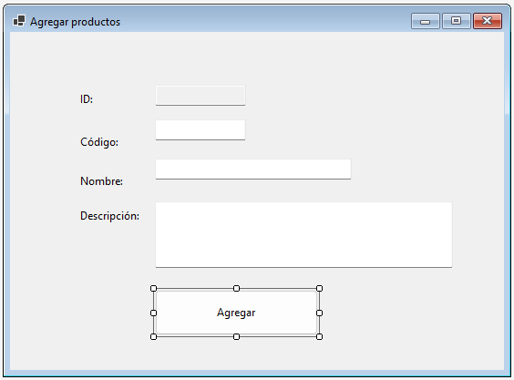

# Clases y métodos - EL, DAL y BLL

## Clase `Producto` 

:books: Recuerde que toda clase como Producto, Categoria, Cliente, etc. debe crearse en la capa InventarioAC.EL.  

```csharp
public class Producto
{
    public int Id { get; set; }
    public string? Codigo { get; set; }
    public string? Nombre { get; set; }
    public string? Descripcion { get; set; }
    public Categoria? Categoria { get; set;  }
    public Producto() { }
    public Producto(int id) {  Id = id; }
    public Producto(int id, string codigo, string nombre, string descripcion, Categoria categoria) {
        Id = id;
        Codigo = codigo;
        Nombre = nombre;
        Descripcion = descripcion;
        Categoria = categoria;
    }
}
```
## Método `Agregar` de la clase `ProductoDAL`

```csharp
public static int Agregar(Producto param1)
{
    int id = 0; // Para indicar que no se ha agrega el empleado.
    try
    {
        using (SqlConnection conn = ConexionBD.Conectar())
        {

            SqlCommand cmd = new SqlCommand("insert into Productos(Codigo, Nombre, Descripcion, CategoriaId) OUTPUT INSERTED.Id values(@Codigo,@Nombre,@Descripcion, @CategoriaId)", conn);
            cmd.Parameters.AddWithValue("@Codigo", param1.Codigo);
            cmd.Parameters.AddWithValue("@Nombre", param1.Nombre);
            cmd.Parameters.AddWithValue("@Descripcion", param1.Descripcion);
            cmd.Parameters.AddWithValue("@CategoriaId", param1.Categoria.Id);
            object resultado = cmd.ExecuteScalar();
            if (resultado != null && resultado != DBNull.Value)
            {
                id = Convert.ToInt32(resultado);
            }
            conn.Close();
        }
    }
    catch (Exception ex)
    {
        new Log(ex.Message);
    }
    return id;
}
```

## Método `Actualizar` de la clase `ProductoDAL`

```csharp
public static bool Actualizar(Producto param1)
{
    bool actualizado = false; // actualizado = true cuando el registro se actualiza
    try
    {
        using (SqlConnection conn = ConexionBD.Conectar())
        {

            SqlCommand cmd = new SqlCommand("update Productos set Codigo = @Codigo, Nombre = @Nombre, Descripcion = @Descripcion, CategoriaId = @CategoriaId Where Id = @Id", conn);
            cmd.Parameters.AddWithValue("@Id", param1.Id);
            cmd.Parameters.AddWithValue("@Codigo", param1.Codigo);
            cmd.Parameters.AddWithValue("@Nombre", param1.Nombre);
            cmd.Parameters.AddWithValue("@Descripcion", param1.Descripcion);
            cmd.Parameters.AddWithValue("@CategoriaId", param1.Categoria.Id);
            int resultado = cmd.ExecuteNonQuery();
            actualizado = (resultado > 0);
            conn.Close();
        }
    }
    catch (Exception ex)
    {
        new Log(ex.Message);
    }
    return actualizado;
}
```

## Método `Eliminar` de la clase `ProductoDAL`

```csharp
public static bool Eliminar(Producto param1)
{
    bool eliminado = false; // eliminado = true cuando el registro se elimina
    try
    {
        using (SqlConnection conn = ConexionBD.Conectar())
        {

            SqlCommand cmd = new SqlCommand("delete from Productos Where Id = @Id", conn);
            cmd.Parameters.AddWithValue("@Id", param1.Id);
            int resultado = cmd.ExecuteNonQuery();
            eliminado = (resultado > 0);
            conn.Close();
        }
    }
    catch (Exception ex)
    {
        new Log(ex.Message);
    }
    return eliminado;
}
```

## Método `Buscar(string codigo, string nombre)` de la clase `ProductoDAL` 

Método para buscar productos por código (búsqueda exacta) o por nombre de producto. La búsqueda por nombre utiliza `LIKE`, comando de base de datos para buscar partes de cadena dentro de un campo.  

:warning: Este método **NO** es parte de la interfaz `ICatalogo`. Observe que recibe dos parámetros: `código` y `nombre`; pero en la interfaz `ICatalogo` ningún método llamado `Buscar` recibe los parámetros `codigo` y `nombre`.  

```csharp
public static List<Producto> Buscar(string codigo, string nombre)
{
    List<Producto> lista = null;
    try
    {
        using (SqlConnection conn = ConexionBD.Conectar())
        {

            SqlCommand cmd = new SqlCommand("select Id,isnull(Codigo,''),Nombre,isnull(Descripcion,''), CategoriaId from Productos Where Codigo = @Codigo or Nombre LIKE @Nombre", conn);
            
            cmd.Parameters.AddWithValue("@Codigo", codigo);
            cmd.Parameters.AddWithValue("@Nombre", "%" + nombre + "%");
            
            SqlDataReader lector = cmd.ExecuteReader();
            if (lector.HasRows)
            {
                lista = new List<Producto>();
                while (lector.Read())
                {
                    Producto producto = new Producto(
                            lector.GetInt32(0),
                            lector.GetString(1),
                            lector.GetString(2),
                            lector.GetString(3),
                            CategoriaDAL.Buscar(new Categoria(lector.GetInt32(4)))
                        );

                    lista.Add(producto);
                }
                lector.Close();
            }
            conn.Close();
        }
    }
    catch (Exception ex)
    {
        new Log(ex.Message);
    }
    return lista;
}
```

## Método `Agregar` de la clase `ProductoBLL`
```csharp
public static int Agregar(Producto param1)
{
    return ProductoDAL.Agregar(param1);
}
```

## Método `Actualizar` de la clase `ProductoBLL`

```csharp
public static bool Actualizar(Producto param1)
{
    return ProductoDAL.Actualizar(param1);
}
```

## Método `Eliminar` de la clase `ProductoBLL` 
```csharp
public static bool Eliminar(Producto param1)
{
    return ProductoDAL.Eliminar(param1);
}
```

## Método `Buscar(string codigo, string nombre)` en la clase `ProductoBLL`  

:warning: Este método tampoco forma parte de la interfaz `ICatalogo`. Se creó para ejecutar al método `Buscar(string codigo, string nombre)` programado anteriormente en la clase `ProductoDAL`.  

```csharp
public static List<Producto> Buscar(string codigo, string nombre)
{
    return ProductoDAL.Buscar(codigo, nombre);
}
```

# FormAgregarProducto

:books: Aquí encontrará las clases y métodos necesarios para agregar productos en una tabla de base de datos.

# Diseño del formulario

  

<table>
<tr>
<th>Nombre del control</th>
<th>Descripción</th>
</tr>
<tr>
<td>txtId</td>
<td>ID del producto</td>
</tr>
</tr>
<td>txtCodigo</td>
<td>Código del producto</td>
</tr>
<tr>
<td>txtNombre</td>
<td>Nombre del producto</td>
</tr>
<tr>
<td>txtDescripcion</td>
<td>Descripción del producto</td>
</tr>
<tr>
<td>cboCategorias</td>
<td>Combo de categorías de productos</td>
</tr>
<tr>
<td>btnNuevo</td>
<td>Limpiar el formulario para crear un nuevo producto</td>
</tr>
<tr>
<td>btnAgregar</td>
<td>Agregar el producto en la tabla de base de datos</td>
</tr>
<tr>
<td>btnLista</td>
<td>Abrir el formulario para buscar, editar y eliminar productos</td>
</tr>
<tr>
<td>btnCerrar</td>
<td>Cerrar el formulario</td>
</tr>
<table>

## Evento `Click` del botón `btnAgregar`  

```csharp
private void btnAgregar_Click(object sender, EventArgs e)
{
    string codigo = txtCodigo.Text.Trim();
    string nombre = txtNombre.Text.Trim();
    string descripcion = txtDescripcion.Text.Trim();
    Categoria? categoria = cboCategorias.SelectedItem as Categoria;
    Producto p = new Producto(-1, codigo, nombre, descripcion, categoria);
    if (btnAgregar.Text == "Agregar")
    {
        int id = ProductoBLL.Agregar(p);
        if (id > 0)
        {
            txtId.Text = id.ToString();
            MessageBox.Show("El producto se agregó", "Resultado", MessageBoxButtons.OK, MessageBoxIcon.Information);
        }
        else
        {
            MessageBox.Show("El producto NO se agregó", "Resultado", MessageBoxButtons.OK, MessageBoxIcon.Warning);
        }
        btnAgregar.Text = "Actualizar";
    }
    else
    {
        p.Id = Convert.ToInt32(txtId.Text);
        bool actualizado = ProductoBLL.Actualizar(p);
        if (actualizado)
        {
            MessageBox.Show("El producto se actualizó", "Resultado", MessageBoxButtons.OK, MessageBoxIcon.Information);
        }
        else
        {
            MessageBox.Show("El producto NO se actualizó", "Resultado", MessageBoxButtons.OK, MessageBoxIcon.Warning);
        }
    }
}
```

## Evento `Load` de `FormAgregarProducto` 

:warning: Para programar este evento se hace `doble click` sobre la ventana. Asegúrese de no hacer doble click en algún botón, cuadro de texto u otro control.  

:dart: Estas instrucciones tienen como objetivo ubicar el formulario `FormAgregarProducto` en la esquina superior izquierda del fomulario `MdiParent1` y llenar el combo `cboCategorias` con las categorías de productos.  

```csharp
private void FormAgregarProducto_Load(object sender, EventArgs e)
{
    this.StartPosition = FormStartPosition.Manual;
    this.Location = new Point(0, 0);
    List<Categoria> categorias = CategoriaBLL.ObtenerTodos();
    cboCategorias.DataSource = categorias;
    cboCategorias.DisplayMember = "Nombre";
    cboCategorias.ValueMember = "Id";
    cboCategorias.SelectedIndex = -1;
}
```

## Evento `Click` del botón `btnLista`  

```csharp
private void btnLista_Click(object sender, EventArgs e)
{
    FormListaProductos form = new FormListaProductos();
    form.EventoActualizarProducto += new FormListaProductos.DelegadoActualizarProducto(MostrarDatosProducto);
    form.ShowDialog();
}
```