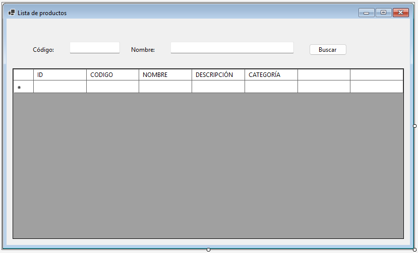

# Búsqueda de productos

## Sobrecarga del método Buscar() en la clase ProductoDAL

:books: Este método será usado para buscar productos por código (búsqueda exacta) o por aproximación usando LIKE mediante el campo nombre.  

:zap: Este método NO es parte de la interfaz. Observe que recibe un código y un nombre; pero en la interfaz ICatalogo<T> ningún método recibe estos dos parámetros. Así, usted puede agregar más métodos en una clase si es necesario.  

```csharp
public static List<Producto> Buscar(string codigo, string nombre)
{
    List<Producto> lista = null;
    try
    {
        using (SqlConnection conn = ConexionBD.Conectar())
        {

            SqlCommand cmd = new SqlCommand("select Id,isnull(Codigo,''),Nombre,isnull(Descripcion,''), CategoriaId from Productos Where Codigo = @Codigo or Nombre LIKE @Nombre", conn);
            
            cmd.Parameters.AddWithValue("@Codigo", codigo);
            cmd.Parameters.AddWithValue("@Nombre", "%" + nombre + "%");
            
            SqlDataReader lector = cmd.ExecuteReader();
            if (lector.HasRows)
            {
                lista = new List<Producto>();
                while (lector.Read())
                {
                    Producto producto = new Producto(
                            lector.GetInt32(0),
                            lector.GetString(1),
                            lector.GetString(2),
                            lector.GetString(3),
                            CategoriaDAL.Buscar(new Categoria(lector.GetInt32(4)))
                        );

                    lista.Add(producto);
                }
                lector.Close();
            }
            conn.Close();
        }
    }
    catch (Exception ex)
    {
        new Log(ex.Message);
    }
    return lista;
}
```

## Sobrecarga del método Buscar() en la clase ProductoBLL

:warning: Este método tampoco forma parte de la interfaz. Se creó para ejecutar al método Buscar creado anteriormente en ProductoDAL (arriba) y enviar datos al formulario.  
```csharp
public static List<Producto> Buscar(string codigo, string nombre)
{
    return ProductoDAL.Buscar(codigo, nombre);
}
```

## FormListaProductos

:books: Este formulario permitirá buscar productos y mostrar sus datos, editar o eliminar productos.  

  

Nombres de los controles: txtCodigo, txtNombre, btnBuscar, dgvProductos

## Código del evento Click del botón btnBuscar

```csharp
private void btnBuscar_Click(object sender, EventArgs e)
{
    string cod = txtCodigo.Text.Trim();
    string nomb = txtNombre.Text.Trim();
    List<Producto> lista = ProductoBLL.Buscar(cod, nomb);
    dgvProductos.Rows.Clear();
    foreach (Producto p in lista)
    {
        object[] data = {
                p.Id,
                p.Codigo,
                p.Nombre,
                p.Descripcion,
                p.Categoria,
                "",
                "" };
        dgvProductos.Rows.Add(data);
    }
}
```

## Evento Load del formulario FormListaProductos

:warning: Para ir al evento Load, haga doble click sobre el formulario.  

```csharp
private void FormListaProductos_Load(object sender, EventArgs e)
{
    dgvProductos.AllowUserToAddRows = false;
}
```

## Evento Painting de dgvProductos en FormListaProductos

:books: Los iconos `editar.ico` y `eliminar.ico` debe copiarlos en el directorio donde se crear el archivo ejecutable. En mi caso es en la carpeta `C:\Users\Miguel Cortez\source\repos\InventarioAC\InventarioAC.UI\bin\Debug\net10.0-windows`

```csharp
private void dgvProductos_CellPainting(object sender, DataGridViewCellPaintingEventArgs e)
{
    if (e.ColumnIndex > 0 && dgvProductos.Columns[e.ColumnIndex].Name == "Column6" && e.RowIndex >= 0)
    {
        e.Paint(e.CellBounds, DataGridViewPaintParts.All);
        Icon icon = new Icon(Environment.CurrentDirectory + @"\editar.ico");
        if (e.Graphics != null)
        {
            e.Graphics.DrawIcon(icon, e.CellBounds.Left + 3, e.CellBounds.Top + 3);
            dgvProductos.Rows[e.RowIndex].Height = icon.Height + 10;
            dgvProductos.Columns[e.ColumnIndex].Width = icon.Width + 10;
            e.Handled = true;
        }
    }
    if (e.ColumnIndex > 0 && dgvProductos.Columns[e.ColumnIndex].Name == "Column7" && e.RowIndex >= 0)
    {
        e.Paint(e.CellBounds, DataGridViewPaintParts.All);
        Icon icon = new Icon(Environment.CurrentDirectory + @"\eliminar.ico");
        if (e.Graphics != null)
        {
            e.Graphics.DrawIcon(icon, e.CellBounds.Left + 3, e.CellBounds.Top + 3);
            dgvProductos.Rows[e.RowIndex].Height = icon.Height + 10;
            dgvProductos.Columns[e.ColumnIndex].Width = icon.Width + 10;
            e.Handled = true;
        }
    }
}
```

