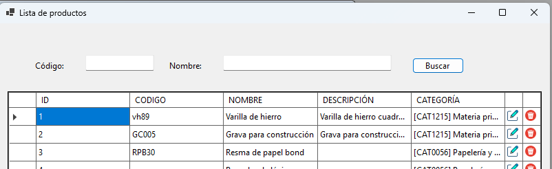
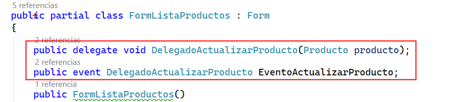

# FormListaProductos

:dart: Formulario para buscar información de productos. Luego de encontrar la información, usted podrá seleccionar un producto para editar o eliminar.  

## Diseño del formulario

  

<table>
<tr>
<th>Nombre del control</th>
<th>Descripción</th>
</tr>
<tr>
<td>txtCodigo</td>
<td>Código del producto que se quiere buscar</td>
</tr>
<tr>
<td>txtNombre</td>
<td>Nombre o parte del nombre del producto que se quiere buscar</td>
</tr>
<tr>
<td>btnBuscar</td>
<td>Botón para realizar la búsqueda de producto</td>
</tr>
<tr>
<td>dgvProductos</td>
<td>Grid que se usa para mostrar la información de los productos encontrados</td>
</tr>
</table>

El formulario en ejecución se verá así:  

  

## Delegado y evento

Agregue las líneas que se muestran destacadas con el borde de color rojo.  

  

## Evento `Click` del botón `btnBuscar` 

```csharp
private void btnBuscar_Click(object sender, EventArgs e)
{
    string cod = txtCodigo.Text.Trim();
    string nomb = txtNombre.Text.Trim();
    List<Producto> lista = ProductoBLL.Buscar(cod, nomb);
    dgvProductos.Rows.Clear();
    foreach (Producto p in lista)
    {
        object[] data = {
                p.Id,
                p.Codigo,
                p.Nombre,
                p.Descripcion,
                p.Categoria,
                "",
                "" };
        dgvProductos.Rows.Add(data);
    }
}
```

## Evento `Load` del formulario

:warning: Para ir al evento Load, haga `doble click` sobre el formulario.  

```csharp
private void FormListaProductos_Load(object sender, EventArgs e)
{
    dgvProductos.AllowUserToAddRows = false;
}
```

## Evento `CellPainting` de `dgvProductos`  

```csharp
private void dgvProductos_CellPainting(object sender, DataGridViewCellPaintingEventArgs e)
{
    if (e.ColumnIndex > 0 && dgvProductos.Columns[e.ColumnIndex].Name == "Column6" && e.RowIndex >= 0)
    {
        e.Paint(e.CellBounds, DataGridViewPaintParts.All);
        Icon icon = new Icon(Environment.CurrentDirectory + @"\editar.ico");
        if (e.Graphics != null)
        {
            e.Graphics.DrawIcon(icon, e.CellBounds.Left + 3, e.CellBounds.Top + 3);
            dgvProductos.Rows[e.RowIndex].Height = icon.Height + 10;
            dgvProductos.Columns[e.ColumnIndex].Width = icon.Width + 10;
            e.Handled = true;
        }
    }
    if (e.ColumnIndex > 0 && dgvProductos.Columns[e.ColumnIndex].Name == "Column7" && e.RowIndex >= 0)
    {
        e.Paint(e.CellBounds, DataGridViewPaintParts.All);
        Icon icon = new Icon(Environment.CurrentDirectory + @"\eliminar.ico");
        if (e.Graphics != null)
        {
            e.Graphics.DrawIcon(icon, e.CellBounds.Left + 3, e.CellBounds.Top + 3);
            dgvProductos.Rows[e.RowIndex].Height = icon.Height + 10;
            dgvProductos.Columns[e.ColumnIndex].Width = icon.Width + 10;
            e.Handled = true;
        }
    }
}
```

Los iconos  `editar.ico` y  `eliminar.ico` deben ser copiados en el directorio del archivo ejecutable. En mi caso, es el directorio `C:\Users\Miguel Cortez\source\repos\InventarioAC\InventarioAC.UI\bin\Debug\net10.0-windows`.  

### ¿Cómo obtener un icono?
1. **Primera opción**. Buscar en su computadora, con el comodín *.ico en `CMD` o el `Explorador de Windows`.  

2. **Segunda opción**. Buscar archivos de tio ICO en Internet.

    :zap: Existen muchos sitios en Internet para descargar imágenes en diferentes formatos. Una página es https://icon-icons.com/es/ 

3. **Tercera opción**. Si tiene una imagen, la puede convertir a archivo de tipo ICO. Existen muchos sitios web que permiten convertir imágenes. Una página web que puede usar es https://imagen.online-convert.com/es/convertir-a-ico


## Evento `CellMouseClick` de `dgvProductos`
```csharp
private void dgvProductos_CellMouseClick(object sender, DataGridViewCellMouseEventArgs e)
{
    if (dgvProductos.CurrentRow != null)
    {
        int id = Convert.ToInt32(dgvProductos.CurrentRow.Cells[0].Value);
        switch (e.ColumnIndex)
        {
            case 5: // Editar
                DataGridViewRow row = dgvProductos.CurrentRow;
                Producto producto = new Producto(
                    Convert.ToInt32(row.Cells[0].Value),
                    Convert.ToString(row.Cells[1].Value),
                    Convert.ToString(row.Cells[2].Value),
                    Convert.ToString(row.Cells[3].Value),
                    (Categoria)row.Cells[4].Value
                    );

                EventoActualizarProducto(producto);
                break;
            case 6: // Eliminar
                if (MessageBox.Show("¿Está seguro de eliminar el registro?",
                    "Eliminar registro", MessageBoxButtons.YesNo,
                    MessageBoxIcon.Question) == DialogResult.Yes)
                {
                    bool eliminado = ProductoBLL.Eliminar(new Producto(id));
                    if (eliminado)
                    {
                        dgvProductos.Rows.Remove(dgvProductos.CurrentRow);
                        MessageBox.Show("El registro fue eliminado", "Registro eliminado",
                            MessageBoxButtons.OK, MessageBoxIcon.Information);
                    }
                }
                break;
        }
    }
    else
    {
        MessageBox.Show("Seleccione una fila", "Alerta", MessageBoxButtons.OK, MessageBoxIcon.Information);
    }
}
```