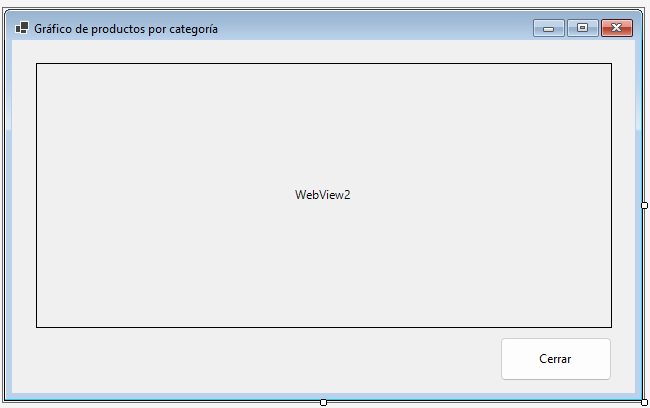
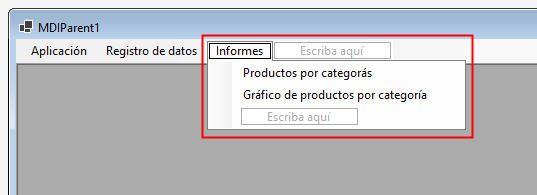
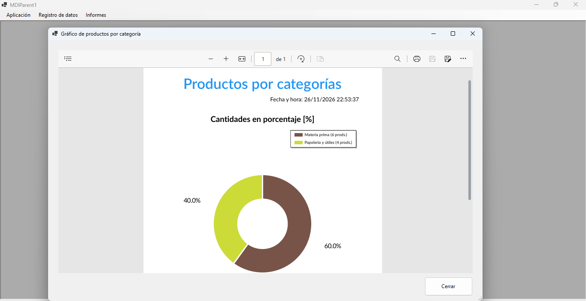

# Creación de gráficos con QuestPDF y ScottPlot

## Documentación oficial de QuestPDF

Creación de gráficos: https://www.questpdf.com/api-reference/charts.html

Adicionalmente, puede ser de interés trazar líneas: https://www.questpdf.com/api-reference/line.html

## Gráfico estadístico de productos por categorías

### 1. En la capa `InventarioAC.EL`, agregue una nueva clase con nombre `EstadisticaProductoVM` 

```csharp
public class EstadisticaProductoVM
{
    public string? Nombre { get; set; }
    public int Total { get; set; }
}
```

### 2. En la clase `CategoriaDAL`, agregue el método `EstadisticaProductoCategoria()`    

```csharp
public static List<EstadisticaProductoVM>? EstadisticaProductoCategoria()
{
    List<EstadisticaProductoVM>? lista = null;
    try
    {
        using (SqlConnection conn = ConexionBD.Conectar())
        {

            SqlCommand cmd = new SqlCommand("select a.Nombre,count(a.Nombre) as Total from Categorias a inner join Productos b on a.Id = b.CategoriaId group by a.Nombre", conn);

            SqlDataReader lector = cmd.ExecuteReader();

            if (lector.HasRows)
            {
                lista = new List<EstadisticaProductoVM>();
                while (lector.Read())
                {
                    lista.Add(
                        new EstadisticaProductoVM {
                            Nombre = lector.GetString(0),
                            Total = lector.GetInt32(1)
                        }
                    );
                }
                lector.Close();
            }
            conn.Close();
        }
    }
    catch (Exception ex)
    {
        new Log(ex.Message);
    }
    return lista;
}
```

### 3. En la clase `CategoriaBLL`, agregue el método `EstadisticaProductoCategoria()`    

```csharp
public static List<EstadisticaProductoVM>? EstadisticaProductoCategoria()
{
    return CategoriaDAL.EstadisticaProductoCategoria();
}
```

### 4. En la capa `InventarioAC.UI`, agregue un formulario con nombre `PDFGraficoEstadisticaProductosCategoria`    

  

### 5. Programe el formulario `PDFGraficoEstadisticaProductosCategoria`   

***Using***  

```csharp
using System;
using System.Collections.Generic;
using System.ComponentModel;
using System.Data;
using System.Drawing;
using System.Text;
using System.Windows.Forms;
using ScottPlot;
using Colors = QuestPDF.Helpers.Colors;
using QuestPDF.Fluent;
using QuestPDF.Helpers;
using QuestPDF.Infrastructure;
using InventarioAC.EL;
using InventarioAC.BLL;
```

***Variable privada a nivel de formulario***

```csharp
private List<EstadisticaProductoVM>? lista;
```

***Modifique el constructor del formulario***

:books: Nota. En el constructor debe recibir los `datos` y asignar su contenido a la variable privada `lista` como se muestra en el siguiente código:  

```csharp
public PDFGraficoEstadisticoProductosCategoria(List<EstadisticaProductoVM>? datos)
{
    InitializeComponent();
    lista = datos;
}
```

***Programe el evento `Load` del formulario `PDFGraficoEstadisticoProductosCategoria`***

```csharp
private void PDFGraficoEstadisticaProductosCategoria_Load(object sender, EventArgs e)
{
    QuestPDF.Settings.License = LicenseType.Evaluation;

    Document.Create(container =>
    {
        container.Page(page =>
        {
            page.Size(PageSizes.A4);
            page.Margin(2, Unit.Centimetre);
            page.PageColor(Colors.White);
            page.DefaultTextStyle(x => x.FontSize(20));

            page.Header()
                .Column(column =>
                {
                    column.Item().Text("Productos por categorías").SemiBold()
                        .FontSize(36)
                        .FontColor(Colors.Blue.Medium)
                        .AlignCenter();
                    column.Spacing(10);

                    column.Item().Text($"Fecha y hora: {DateTime.Now:dd/MM/yyyy HH:mm:ss}")
                        .FontSize(14)
                        .AlignRight();
                });

            page.Content()
                .PaddingVertical(1, Unit.Centimetre)
                .Column(column =>
                {
                    column.Spacing(10);

                    column.Item().Text("Cantidades en porcentaje [%]").AlignCenter().Bold();

                    column.Item()
                        .AspectRatio(1)
                        .Svg(size =>
                        {
                            ScottPlot.Plot plot = new();
                            List<PieSlice> slices = new List<PieSlice>();
                            var colores = new ScottPlot.Color[]
                            {
                                new ScottPlot.Color(Colors.Yellow.Medium.Hex),
                                new ScottPlot.Color(Colors.Green.Medium.Hex),
                                new ScottPlot.Color(Colors.Blue.Medium.Hex),
                                new ScottPlot.Color(Colors.Brown.Medium.Hex),
                                new ScottPlot.Color(Colors.Cyan.Medium.Hex),
                                new ScottPlot.Color(Colors.Purple.Medium.Hex),
                                new ScottPlot.Color(Colors.Orange.Medium.Hex),
                                new ScottPlot.Color(Colors.Lime.Medium.Hex)
                            };
                            Random random = new Random();
                            foreach (EstadisticaProductoVM item in lista)
                            {
                                slices.Add(new() { Value = item.Total, FillColor = colores[random.Next(0, colores.Length)], Label = item.Nombre });
                            }
                            var pie = plot.Add.Pie(slices.ToArray());
                            pie.DonutFraction = 0.5;
                            pie.SliceLabelDistance = 1.5;
                            pie.LineColor = ScottPlot.Colors.White;
                            pie.LineWidth = 3;

                            double total = slices.Sum(x => x.Value);
                            foreach (var pieSlice in pie.Slices)
                            {
                                double porcentaje = (pieSlice.Value / total) * 100;
                                pieSlice.LabelStyle.FontName = "Lato";
                                pieSlice.LabelStyle.FontSize = 16;
                                pieSlice.LegendText = $"{pieSlice.Label} ({pieSlice.Value} prods.)";
                                pieSlice.Label = $"{porcentaje:N1}%";
                            }
                            plot.ShowLegend(Alignment.UpperRight);
                            plot.Legend.FontName = "Lato";
                            plot.Legend.FontSize = 10;
                            plot.Axes.Frameless();
                            plot.HideGrid();

                            return plot.GetSvgXml((int)size.Width, (int)size.Height);
                        });
                });

            page.Footer()
                .AlignCenter()
                .Text(x =>
                {
                    x.Span("Página ");
                    x.CurrentPageNumber();
                });
        });
    })
    .GeneratePdf("grafico_productos_categoria.pdf");
    string rutaPDF = @"C:\Users\Miguel Cortez\source\repos\InventarioAC\InventarioAC.UI\bin\Debug\net10.0-windows\grafico_productos_categoria.pdf";

    webView21.Source = new Uri(rutaPDF);
}
```

***Programe el botón `btnCerrar`***  

```csharp
private void btnCerrar_Click(object sender, EventArgs e)
{
    this.Dispose();
}
```

### 6. En el formulario `MDIParent1`, agregue el menú de informes como se muestra en la siguiente imagen.  

  

Siempre en el formulario `MDIParent1` agregue los `using` siguientes:  

```csharp
using InventarioAC.EL;
using InventarioAC.BLL;
```

En la opción de menú `Gráfico de productos por categoría`, agregue las instrucciones para mostrar el gráfico estadístico de productos por categoría.  

```csharp
List<EstadisticaProductoVM>? lista = CategoriaBLL.EstadisticaProductoCategoria();
if (lista != null && lista.Count > 0)
{
    PDFGraficoEstadisticoProductosCategoria form = new PDFGraficoEstadisticoProductosCategoria(lista);
    form.ShowDialog();
}
else
{
    MessageBox.Show("No hay datos para graficar", "Alerta", MessageBoxButtons.OK, MessageBoxIcon.Warning);
}
```

### 7. Ejecute la aplicación y muestre el gráfico estadístico de productos por categorías.  

  

