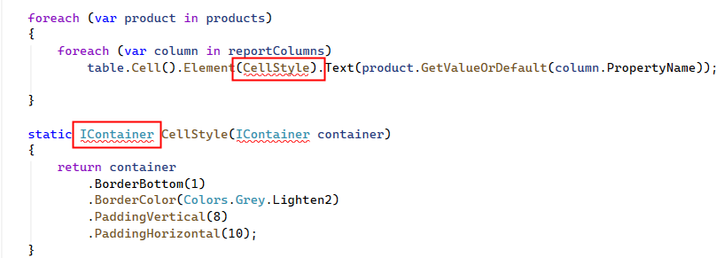

# PDF

Instale los siguientes paquetes:
- QuestPDF
- Microsoft.Web.WebView2

  

**QuestPDF** se usa para generar archivos PDF.  

**Microsoft.Web.WebView2** se usa para mostrar archivos PDF en **Windows Forms**.  

Descarga de íconos  

   

https://www.flaticon.es/


## URL para crear el primer ejemplo de informe PDF  
https://www.questpdf.com/quick-start.html

## URL para ver la estructura básica de una página  

https://www.questpdf.com/api-reference/page/basics.html

## URL para crear la tabla con datos dinámicos desde elementos JSON:  

https://www.questpdf.com/concepts/dynamic-composition/configurable-tables.html


```csharp
private void chkTodas_CheckedChanged(object sender, EventArgs e)
{
    if (chkTodas.Checked)
    {
        cboCategorias.Visible = false;
        label1.Visible = false;
    }
    else
    {
        cboCategorias.Visible = true;
        label1.Visible = true;
    }
}
```


## Implementación de tabla con datos dinámicos - Basados en la documentación oficial de QuestPDF

Se presentó un error en el uso de la interfaz `IContainer`. El error ocurre porque la interfaz `IContainer` existe en dos espacios de nombre que se han importado.  


  

:eye: Los espacios de nombres que tienen la interfaz `IContainer` son los siguientes:  

```csharp
using System.ComponentModel; // 🔖 Este espacio de nombres no es el correcto para crear el informe PDF con QuestPDF; pero creo que se agregó automáticamente cuando se pegó el código de ejemplo desde la documentación de QuestPDF.  
using QuestPDF.Infrastructure;
```

:warning: Si el formulario `PDFProductos` tiene el espacio de nombres `using System.ComponentModel;` elimine esa línea.  

NOTAS: 25/11/2026

:books: Programe el método ObtenerTodos() en ProductoDAL  

:books: Programe el método Obtener(Categoria categoria) en ProductoDAL  

:books: Programe el método ObtenerTodos() en ProductoBLL  

:books: Programe el método Obtener(Categoria categoria) en ProductoBLL  

## Evento `Click` del botón `btnGeneerarPDF` 

```csharp
private void btnGenerarPDF_Click(object sender, EventArgs e)
{
    var reportColumns = new List<ReportColumn>
    {
        new(Header: "ID",        IsConstantWidth: true,  Size: 40),
        new(Header: "CÓDIGO",    IsConstantWidth: false, Size: 60),
        new(Header: "NOMBRE",  IsConstantWidth: false, Size: 100),
        new(Header: "DESCRIPCIÓN",   IsConstantWidth: false,  Size: 150),
        new(Header: "CATEGORÍA", IsConstantWidth: false,  Size: 150)
    };
    List<Producto> productos = null;
    if(chkTodas.Checked)
        productos = ProductoBLL.ObtenerTodos();
    else
    {
        if(cboCategorias.SelectedIndex != -1)
        {
            productos = ProductoBLL.Obtener(cboCategorias.SelectedItem as Categoria);
            reportColumns = new List<ReportColumn>
            {
                new(Header: "ID",        IsConstantWidth: true,  Size: 40),
                new(Header: "CÓDIGO",    IsConstantWidth: false, Size: 60),
                new(Header: "NOMBRE",  IsConstantWidth: false, Size: 100),
                new(Header: "DESCRIPCIÓN",   IsConstantWidth: false,  Size: 150)
            };
        }
        else
        {
            MessageBox.Show("No ha seleccionado una categoría", "Seleccione una categoría", MessageBoxButtons.OK, MessageBoxIcon.Warning);
            return;
        }
    }
    QuestPDF.Settings.License = LicenseType.Evaluation;

    Document.Create(container =>
    {
        container.Page(page =>
        {
            page.Size(PageSizes.A4);
            page.Margin(2, Unit.Centimetre);
            page.PageColor(Colors.White);
            page.DefaultTextStyle(x => x.FontSize(10));


            page.Header()
                .Column(column =>
                {
                    column.Item().Text("Informe de productos")
                    .SemiBold().FontSize(14).FontColor(Colors.Blue.Medium);

                    if (!chkTodas.Checked && cboCategorias.SelectedIndex != -1)
                    {
                        column.Item()
                            .Text((cboCategorias.SelectedItem as Categoria).Nombre)
                            .FontSize(12)
                            .FontColor(Colors.Grey.Medium);
                    }
                });


            page.Content()
                .PaddingVertical(1, Unit.Centimetre)
                .Column(x =>
                {
                    x.Spacing(20);

                    x.Item().Table(table =>
                    {
                        table.ColumnsDefinition(columns =>
                        {
                            foreach (var column in reportColumns)
                            {
                                if (column.IsConstantWidth)
                                    columns.ConstantColumn(column.Size);
                                else
                                    columns.RelativeColumn(column.Size);
                            }
                        });

                        table.Header(header =>
                        {
                            foreach (var column in reportColumns)
                                header.Cell().Element(HeaderCellStyle).Text(column.Header);

                            static IContainer HeaderCellStyle(IContainer container)
                            {
                                return container
                                    .Background(Colors.Blue.Darken2)
                                    .DefaultTextStyle(x => x.FontColor(Colors.White).SemiBold())
                                    .PaddingVertical(8)
                                    .PaddingHorizontal(10);
                            }
                        });

                        
                        foreach(Producto producto in productos)
                        {

                            table.Cell().Element(CellStyle).Text(producto.Id.ToString());
                            table.Cell().Element(CellStyle).Text(producto.Codigo);
                            table.Cell().Element(CellStyle).Text(producto.Nombre);
                            table.Cell().Element(CellStyle).Text(producto.Descripcion);
                            if (chkTodas.Checked)
                            {
                                table.Cell().Element(CellStyle).Text(producto.Categoria.Nombre);
                            }
                        }
                        static IContainer CellStyle(IContainer container)
                        {
                            return container
                                .BorderBottom(1)
                                .BorderColor(Colors.Grey.Lighten2)
                                .PaddingVertical(8)
                                .PaddingHorizontal(10);
                        }
                    });
                });

            page.Footer()
                .AlignCenter()
                .Text(x =>
                {
                    x.Span("Página ");
                    x.CurrentPageNumber();
                });
        });
    })
    .GeneratePdf("productos.pdf");
    string rutaPDF = @"C:\Users\Miguel Cortez\source\repos\InventarioAC\InventarioAC.UI\bin\Debug\net10.0-windows\productos.pdf";

    webView21.Source = new Uri(rutaPDF);
}
```