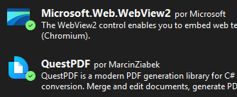

# PDF

Instale los siguientes paquetes:
- QuestPDF
- Microsoft.Web.WebView2

  

**QuestPDF** se usa para generar archivos PDF.  

**Microsoft.Web.WebView2** se usa para mostrar archivos PDF en **Windows Forms**.  

Descarga de íconos  

   

https://www.flaticon.es/


## URL para crear el primer ejemplo de informe PDF  
https://www.questpdf.com/quick-start.html

## URL para ver la estructura básica de una página  

https://www.questpdf.com/api-reference/page/basics.html

## URL para crear la tabla con datos dinámicos desde elementos JSON:  

https://www.questpdf.com/concepts/dynamic-composition/configurable-tables.html


```csharp
private void chkTodas_CheckedChanged(object sender, EventArgs e)
{
    if (chkTodas.Checked)
    {
        cboCategorias.Visible = false;
        label1.Visible = false;
    }
    else
    {
        cboCategorias.Visible = true;
        label1.Visible = true;
    }
}
```


## Implementación de tabla con datos dinámicos - Basados en la documentación oficial de QuestPDF

Se presentó un error en el uso de la interfaz `IContainer`. El error ocurre porque la interfaz `IContainer` existe en dos espacios de nombre que se han importado.  


  

:eye: Los espacios de nombres que tienen la interfaz `IContainer` son los siguientes:  

```csharp
using System.ComponentModel; // 🔖 Este espacio de nombres no es el correcto para crear el informe PDF con QuestPDF; pero creo que se agregó automáticamente cuando se pegó el código de ejemplo desde la documentación de QuestPDF.  
using QuestPDF.Infrastructure;
```

:warning: Si el formulario `PDFProductos` tiene el espacio de nombres `using System.ComponentModel;` elimine esa línea.  

NOTAS: 25/11/2026
:books: Programe el método ObtenerTodos() en ProductoDAL  

:books: Programe el método Obtener(Categoria categoria) en ProductoDAL  

:books: Programe el método ObtenerTodos() en ProductoBLL  

:books: Programe el método Obtener(Categoria categoria) en ProductoDAL  
