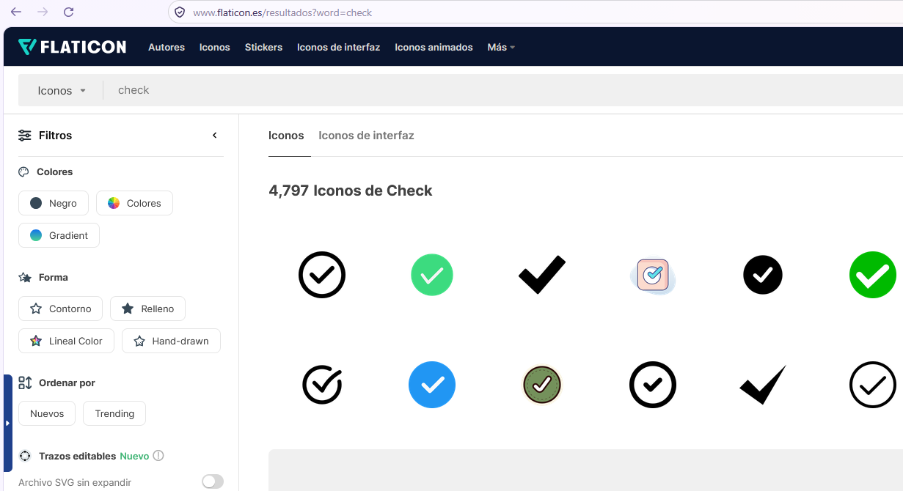

# PDF

Instale los siguientes paquetes:
- QuestPDF
- Microsoft.Web.WebView2

  

**QuestPDF** se usa para generar archivos PDF.  

**Microsoft.Web.WebView2** se usa para mostrar archivos PDF en **Windows Forms**.  

Descarga de íconos  

   

https://www.questpdf.com/quick-start.html

https://www.questpdf.com/api-reference/page/basics.html

