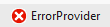
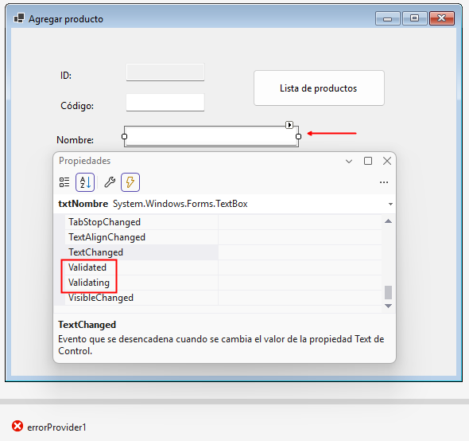
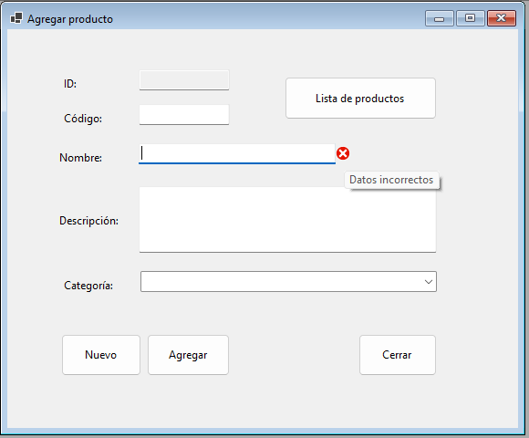

# Validaciones

## ¿Qué es validar?

:sparkles: Validar es **comprobar si los datos que el usuario ingresa son correctos** en función de un conjunto de reglas conocidas.  

:pushpin: ***Por ejemplo, si se trata de un nombre de persona:***  

* No debe contener dígitos.  

* No debe contener caracteres especiales como: `?`, `#`, `$`, `@`, `_`, `;`, `(`,`)`, etc.

* No debe tener menos de 3 caracteres.  

## ¿Cómo validar datos en C#?

* En `C#` se utiliza una clase llamada `ErrorProvider`. 

    

* `ErrorProvider` es una clase que permite gestionar los errores ocurridos durante la captura de datos.  
<hr /> 

Para comenzar el proceso de validación, debe arrastrar al formulario un control `ErrorProvider`. Este control automáticamente se ubicará abajo del formuario. No es necesario cambiar el nombre, por lo tanto, se llamará `ErrorProvider1`.  

Los cuadros de texto `TextBox` tienen varios eventos que pueden ser utilizados para validar la entrada de datos:

* `Validating` y `Validated`.  
* `KeyDown`.  
* `KeyUp`.  
* `KeyPress`, etc.


En el evento elegido para validar, se programa un algoritmo que permita determinar si el dato ingresado es correcto o no es correcto.
Si el dato es correcto, <span style="color:green;font-weight: bold;">se acepta</span> y en caso contrario, <span style="color:red;font-weight: bold;">se rechaza</span>.
La validación no necesariamente se hace en un solo evento.


:large_blue_circle: Particularmente, prefiero utilizar los eventos `Validating` y `Validated`.  

  

***¿Cómo se usan `Validating` y `Validated`?***  

1. En `Validating` se escribe la lógica para determinar si los datos ingresados son válidos o no son válidos.  

2. Si los datos no son válidos, se ejecuta la instrucción `e.Cancel = true;` y se muestra un `mensaje de error`; pero si los datos son correctos se continúa normalmente. Con la ejecución del comando `e.Cancel = true;` se obliga al usario a llenar correctamente el cuadro de texto antes de continuar.  

    Ejemplo de mensaje de error
    ```csharp
    errorProvider1.SetError(txtNombre, “Dato incorrectos”);
    ```  

      

3. En el evento `Validated` se elimina el mensaje de error en caso que haya sido mostrado.  

    ```csharp
    errorProvider1.SetError(txtNombre, String.Empty)
    ```

## Tres formas escribir la lógica de validación  

1. Escribiendo un algoritmo (programa) usando las estructuras de control if, for, while, foreach, etc. de forma manual. Lógica definida por usted como desarrollador (desde cero y sin ayudas adicionales).  

2. Usando expresiones regulares `RegularExpressions`.  

3. Combinando `RegularExpressions` y lógica personalizada por usted usando las estructuras de control como se indicó en el numeral 1.  

### Ejemplo 1. Validación de un código  

:dart: Este ejemplo muestra cómo validar para que un control solo acepte letras o dígitos.  

#### En el evento `Validating` de `txtCodigo` 
```csharp
private void txtCodigo_Validating(object sender, CancelEventArgs e)
{
    if (!String.IsNullOrEmpty(txtCodigo.Text))
    {
        string cad = txtCodigo.Text.Trim();
        CharEnumerator ce = cad.GetEnumerator();
        bool error = false;
        while (ce.MoveNext())
        {
            if (!Char.IsLetterOrDigit(ce.Current))
            {
                error = true;
            }
        }
        if (error)
        {
            errorProvider1.SetError(txtCodigo, "El código no es correcto");
            e.Cancel = true;
        }
    }
}
```

#### En el evento `Validated` de `txtCodigo` 

```csharp

private void txtCodigo_Validated(object sender, EventArgs e)
{
    errorProvider1.SetError(txtCodigo, string.Empty);
}
```

## Definiendo una clase para validación  

```csharp
using System;
using System.Collections.Generic;
using System.Linq;
using System.Text;
using System.Text.RegularExpressions;
using System.Threading.Tasks;

namespace InventarioAC.EL
{
    public class Validacion
    {
        public static bool EsNombre(string s)
        {
            s = s.Trim();
            bool result = false;
            if (s.Length >= 3)
            {
                result = true;
                CharEnumerator ce = s.GetEnumerator();
                while (ce.MoveNext())
                {
                    if (!Char.IsLetter(ce.Current) && !Char.IsWhiteSpace(ce.Current))
                    {
                        result = false;
                    }
                }
            }
            return result;
        }
        public static bool EsCorreo(string s) {
            bool result = false;
            if (s.Length > 0)
            {
                String expresion;
                expresion = "\\w+([-+.']\\w+)*@\\w+([-.]\\w+)*\\.\\w+([-.]\\w+)*";
                if (Regex.IsMatch(s, expresion))
                {
                    if (Regex.Replace(s, expresion, String.Empty).Length == 0)
                    {
                        result = true;
                    }
                    else
                    {
                        result = false;
                    }
                }
                else
                {
                    result = false;
                }
            }
            return result;
        }
    }
}
```

### Ejemplo 2. Validación de un nombre usando la clase de validación  

#### En el evento `Validating` de `txtNombre` 

```csharp
private void txtNombre_Validating(object sender, CancelEventArgs e)
{
    if (!String.IsNullOrEmpty(txtNombre.Text))
    {
        if (!Validacion.EsNombre(txtNombre.Text))
        {
            errorProvider1.SetError(txtNombre, "El nombre no es correcto");
            e.Cancel = true;
        }
    }
}
```

#### En el evento `Validated` de `txtNombre` 

```csharp
private void txtNombre_Validated(object sender, EventArgs e)
{
    errorProvider1.SetError(txtNombre, string.Empty);
}
```

## Documentación para usar expresiones regulares

https://learn.microsoft.com/es-es/dotnet/standard/base-types/regular-expression-language-quick-reference  
