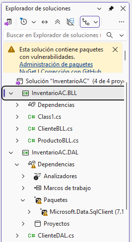
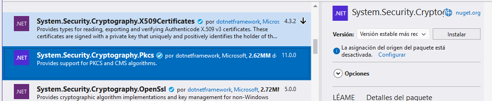
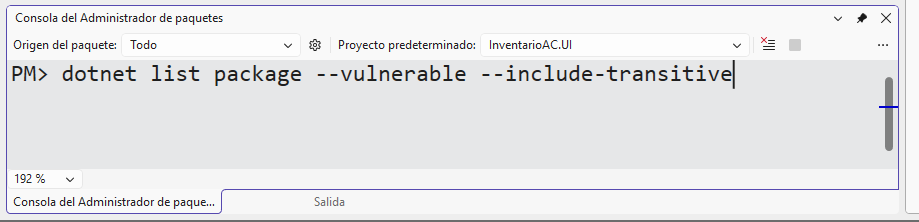

# Vulnerabilidades

## Detalles de la vulnerabilidad
  

```bash
  Determinando los proyectos que se van a restaurar...
C:\Users\Miguel Cortez\source\repos\InventarioAC\InventarioAC.BLL\InventarioAC.BLL.csproj : warning NU1902: El paquete "System.Security.Cryptography.Pkcs" 9.0.18 tiene una vulnerabilidad de gravedad moderada conocida, https://github.com/advisories/GHSA-2fmv-rv2c-59x7 [C:\Users\Miguel Cortez\source\repos\InventarioAC\InventarioAC.slnx]
C:\Users\Miguel Cortez\source\repos\InventarioAC\InventarioAC.DAL\InventarioAC.DAL.csproj : warning NU1902: El paquete "System.Security.Cryptography.Pkcs" 9.0.18 tiene una vulnerabilidad de gravedad moderada conocida, https://github.com/advisories/GHSA-2fmv-rv2c-59x7 [C:\Users\Miguel Cortez\source\repos\InventarioAC\InventarioAC.slnx]
C:\Users\Miguel Cortez\source\repos\InventarioAC\InventarioAC.BLL\InventarioAC.BLL.csproj : warning NU1903: El paquete "System.Security.Cryptography.Pkcs" 9.0.18 tiene una vulnerabilidad de gravedad alta conocida, https://github.com/advisories/GHSA-846f-f764-76mx [C:\Users\Miguel Cortez\source\repos\InventarioAC\InventarioAC.slnx]
C:\Users\Miguel Cortez\source\repos\InventarioAC\InventarioAC.DAL\InventarioAC.DAL.csproj : warning NU1903: El paquete "System.Security.Cryptography.Pkcs" 9.0.18 tiene una vulnerabilidad de gravedad alta conocida, https://github.com/advisories/GHSA-846f-f764-76mx [C:\Users\Miguel Cortez\source\repos\InventarioAC\InventarioAC.slnx]
  Todos los proyectos están actualizados para la restauración.

✂️ CÓDIGO OMITIDO

```

## Recomendación

Instalar el paquete con vulnerabilidad a la versión más reciente `9.0.21`. Se puede hacer gráficamente con NuGet o mediante la `Consola del Administrador de paquetes`.

### En entorno gráfico

1. Clic derecho en el nombre del proyecto que tiene la vulnerabilidad.  

2. Clic en Administrador de paquetes NuGet.

3. Busque el paquete reciente e instale

En la siguiente imagen se muestra la versión reciente (11.0.0) del paquete `System.Security.Cryptography.Pkcs`

  

### En la consola de Administrador de paquetes

1. Clic en Herramientas.  

2. Administrador de paquetes NuGet.  

3. Consola del Administrador de paquetes.  

```bash
Install-Package System.Security.Cryptography.Pkcs -Version 11.0.0
```

  
